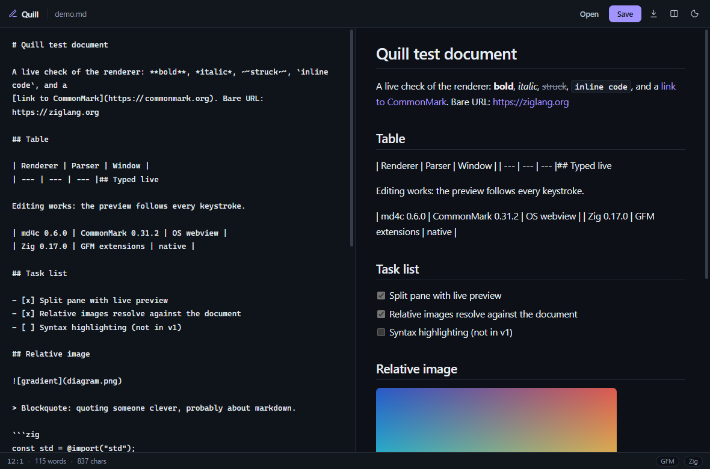

<p align="center">
  <b>Quill</b><br>
  A markdown editor in a native window. Zig core, OS webview surface.
</p>

<p align="center">
  <a href="https://github.com/epicshawty/quill/releases/latest"></a>
  <a href="LICENSE"></a>
  <a href="https://github.com/epicshawty/quill/actions/workflows/ci.yml"></a>
  
  
  
</p>

<p align="center">
  
</p>

One source tree, one small binary per platform, no Node and no C++ in the app.
Zig owns the app, the file I/O and the markdown render call; the OS supplies the
window and the HTML engine.

## Features

- **CommonMark 0.31.2 + GFM** — tables, task lists, strikethrough, bare-URL
  autolinks, fenced code, nested lists. Parsed by [md4c](https://github.com/mity/md4c).
- **Split view with live preview** — draggable divider, `Ctrl+E` for full width.
- **Real editing** — undo, selection, IME, spellcheck and clipboard come from the
  platform instead of being hand-rolled.
- **Relative images render** — `` resolves next to the document and
  is inlined as a `data:` URI.
- **Raw HTML is escaped**; links open in your browser, not inside the app window.

## Install

Grab the archive for your platform from [Releases](https://github.com/epicshawty/quill/releases/latest),
unpack it, run `quill`.

| Platform | Needs |
| --- | --- |
| Windows | WebView2 runtime (ships with Windows 10/11) |
| macOS | nothing, uses system WebKit |
| Linux | `libwebkit2gtk-4.1-0` at runtime |

## Build

Zig 0.17.0, nothing else — md4c is vendored.

```sh
zig build                # zig-out/bin/quill
zig build run
zig build test           # markdown + image inlining tests
zig build -Doptimize=ReleaseSmall
```

Cross-compile for Windows or Linux from any host:

```sh
zig build -Dtarget=x86_64-windows -Doptimize=ReleaseSmall
zig build -Dtarget=aarch64-linux-gnu -Doptimize=ReleaseSmall
```

macOS must be built on macOS: Apple's SDK is not redistributable.

Shipping a binary means building for a baseline CPU, or it will only run on
hardware at least as new as the machine that compiled it:

```sh
zig build -Dcpu=baseline -Doptimize=ReleaseSmall
```

## Usage

```sh
quill               # welcome document
quill notes.md      # open a file, Ctrl+S saves back to it
quill --help
```

`Open` uses the system file picker, which never reveals a real path, so `Save` on
a picker-opened document exports a copy instead of overwriting.

| Key | Action |
| --- | --- |
| `Ctrl+S` / `Ctrl+Shift+S` | save / export a copy |
| `Ctrl+O` | open |
| `Ctrl+E` | toggle preview |
| `Ctrl+B` `Ctrl+I` `Ctrl+K` | bold · italic · link |
| `Ctrl+=` `Ctrl+-` `Ctrl+0` | zoom |

## Source map

```
src/main.zig       app state, JS bindings, page assembly
src/render.zig     markdown -> HTML (md4c, GFM flags)
src/images.zig     relative  -> data: URIs
src/platform.zig   file I/O and "open in browser" — the only OS-specific code
src/assets/        index.html, style.css, app.js, embedded into the binary
```

## Licence

AGPL-3.0-or-later. md4c is MIT, see `deps/md4c/LICENSE.md`.
